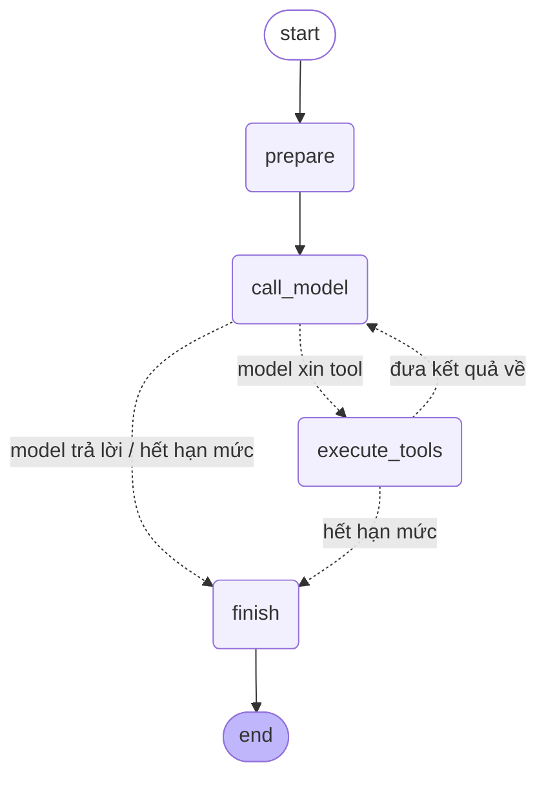

# Agent Harness — SQL analyst

Một **harness** thật: LLM là bộ điều khiển, harness cấp tool, hạn mức, phân quyền, cổng phê duyệt và transcript.

Đối chiếu trực tiếp với [`../Face_AI_Agent`](../Face_AI_Agent) — cùng nền LangGraph, nhưng đó là **workflow** (đường đi do code tính trước) còn đây là **harness** (đường đi do model chọn lúc chạy). Phần §2 so sánh hai cái bằng code, không bằng lời.

**Chạy được ngay, không cần API key:**

```bash
cd Agent_Harness && pip install -r requirements.txt
python -m toolsets.sql.seed
python -m app.cli --demo list
python -m app.cli --demo injection --approve deny --quiet
```

---

## 1. Vì sao bài toán này xứng đáng một harness

Harness không phải lựa chọn mặc định — nó đổi tính tất định lấy tính linh hoạt. Nó chỉ đáng khi **không gian quyết định không liệt kê trước được**. Agent phân tích dữ liệu đạt cả bốn điều kiện:

| Điều kiện | Ở bài toán này |
|---|---|
| Không enumerate được yêu cầu | Người dùng hỏi được bất cứ gì về dữ liệu |
| Số bước phụ thuộc runtime | Phải xem schema *rồi mới* biết viết query gì |
| Cần vòng lặp sửa sai | Query sai cột → đọc lỗi → xem schema → viết lại |
| Mỗi lần một đường khác | Không có hai câu hỏi nào đi cùng một chuỗi tool |

Ngược lại, face search ở project kia có không gian quyết định là **6 intent × 2 dữ kiện** — một bảng tra cứu. Đưa nó cho LLM là đổi một nhánh `if` tất định thành một lời gọi mạng có thể lỗi và có thể chọn sai, mà không được gì.

---

## 2. Harness vs workflow — khác nhau ở đâu trong code

| Câu hỏi | `Face_AI_Agent` (workflow) | `Agent_Harness` (harness) |
|---|---|---|
| Ai quyết định bước tiếp theo? | [`plan.py`](../Face_AI_Agent/app/agent/nodes/plan.py) — bảng tra cứu bằng code | **model**, qua `tool_calls` trong mỗi lượt |
| Ai chọn tool? | [`routing.py`](../Face_AI_Agent/app/agent/routing.py) — hàm thuần | **model**, harness chỉ cấp catalog |
| Tool đăng ký cho LLM? | không | **có** — [`registry.py`](harness/registry.py) |
| Số super-step | biết trước từ `execution_plan` | **không biết** — chỉ biết *giới hạn* |
| Tắt LLM thì sao? | chạy đủ chức năng (template) | **không còn hệ thống** |
| Vòng lặp dừng khi nào? | hết kế hoạch | model không xin tool nữa, **hoặc hết hạn mức** |
| Thứ phải test nhiều nhất | logic nghiệp vụ | **hành vi harness khi model làm sai** |

Cạnh định nghĩa nên harness nằm ở [`loop.py`](harness/loop.py):

```python
def route_after_model(state):
    if state.get("pending_tool_calls"):   # dữ kiện chỉ tồn tại lúc chạy
        return NODE_EXECUTE_TOOLS
    return NODE_FINISH
```

Không có kế hoạch nào nói bước sau là gì.

---

## 3. Kiến trúc

```
harness/          runtime KHÔNG biết domain
  loop.py           vòng lặp call_model <-> execute_tools (LangGraph)
  registry.py       ToolSpec: schema + handler + NHÃN RỦI RO
  policy.py         cổng kiểm soát - không bao giờ đọc output của tool
  budget.py         8 loại hạn mức, chặn TRƯỚC khi tiêu
  model.py          ModelClient: OpenAI thật + ScriptedModel cho test
  runner.py         chạy episode, kể cả phần tạm dừng chờ phê duyệt
  state.py          state serialize được + context không serialize
  transcript.py     bản ghi "agent đã làm gì"
  prompts.py        hợp đồng với model

toolsets/sql/     phần domain, ghép vào qua registry
  tools.py          5 tool: 4 đọc + 1 GHI (cần phê duyệt)
  db.py             SQLite chỉ-đọc + LIMIT + timeout cắt query
  guard.py          allowlist câu lệnh
  seed.py           database demo (có cài sẵn một dòng prompt injection)

app/              lắp đặt + giao diện
  wiring.py         nơi DUY NHẤT harness và toolset gặp nhau
  cli.py            chạy episode, phê duyệt trên stdin
  api.py            HTTP: /ask có thể trả 202 chờ phê duyệt
  demo_scripts.py   8 kịch bản chạy offline
```

`harness/` không import gì từ `toolsets/`, và `toolsets/` không import `harness/loop.py`. Đổi toolset (SQL → filesystem → API nội bộ) không sửa một dòng nào trong harness.

### Vòng lặp



Bốn node, hai cạnh điều kiện — nhỏ hơn workflow ở project kia (11 node) nhưng **không đoán trước được** nó sẽ đi qua bao nhiêu vòng.

---

## 4. Năm lớp kiểm soát

Harness đặt LLM vào vị trí điều khiển, nên mọi thứ an toàn phải nằm **ngoài** model.

### 4.1 Hạn mức — [`budget.py`](harness/budget.py)

Tám loại, mỗi loại chặn một chế độ thất bại khác nhau:

| Hạn mức | Chặn |
|---|---|
| `max_model_calls` | vòng lặp model ⇄ tool không bao giờ kết thúc |
| `max_tool_calls` | gọi tool quá nhiều dù mỗi lượt đều hợp lý |
| `max_tool_calls_per_tool` | kẹt ở **một** tool (gọi `list_tables` 20 lần) |
| `max_identical_tool_calls` | lặp **y nguyên** một lời gọi — không tiến triển |
| `max_active_seconds` | tool chậm/treo kéo episode vô hạn |
| `max_tool_result_chars` | một kết quả khổng lồ làm nổ context |
| `max_total_result_chars` | nhiều kết quả vừa phải **cộng lại** làm nổ context |
| `max_parallel_tool_calls` | một lượt assistant xin 30 tool, tiêu hết hạn mức trong một super-step |

Hai nguyên tắc: kiểm **trước** khi tiêu tài nguyên, và hết hạn mức là **trạng thái kết thúc bình thường** (`status="stopped"` + `stop_reason` có mã ổn định), không phải exception. Người gọi vẫn nhận response dùng được.

`max_active_seconds` đếm **thời gian làm việc**, không đếm thời gian treo — nếu không, một lần chờ phê duyệt 1 tiếng sẽ giết episode ngay khi nó được tiếp tục.

### 4.2 Policy — [`policy.py`](harness/policy.py)

Một bất biến, phải đúng tuyệt đối:

> **Policy không bao giờ đọc output của tool hay nội dung do model sinh ra.**

Nó chỉ quyết định dựa trên: tên tool, nhãn rủi ro khai báo trong `ToolSpec`, quyền của principal, và bộ đếm trong state. Có một test khoá điều này ở mức **chữ ký hàm**:

```python
def test_policy_does_not_look_at_tool_output():
    parameters = set(inspect.signature(evaluate_tool_call).parameters)
    assert parameters == {"spec", "arguments", "state", "permissions", "budget"}
```

Ai thêm một tham số mang nội dung tool result vào sẽ làm test đỏ và phải giải thích vì sao dữ liệu không đáng tin lại được tham gia quyết định.

Nói chính xác: **harness không ngăn model bị thuyết phục. Nó ngăn việc model bị thuyết phục dẫn tới một hành động không ai đồng ý.**

### 4.3 Cổng phê duyệt — human-in-the-loop

`ToolSpec` khai báo `side_effect` và `requires_approval`. Một tool `write` mà không `requires_approval` **không đăng ký được** — chặn lúc đăng ký, không phải lúc chạy:

```python
def test_write_tool_without_approval_is_rejected_at_registration():
    with pytest.raises(ValueError, match="requires_approval"):
        ToolSpec(..., side_effect=SIDE_EFFECT_WRITE, requires_approval=False)
```

`execute_tools` chia **hai pha** — và đây là chi tiết dễ làm sai nhất của HITL:

```
PHA 1 (thuần): validate tham số, hỏi policy — KHÔNG chạy gì
      ↓
  interrupt() một lần cho cả lượt
      ↓
PHA 2: thực thi những gì được đồng ý
```

`interrupt()` làm node **chạy lại từ đầu** khi resume. Nếu node thực thi tuần tự ("tool 1 chạy, tool 2 cần duyệt → interrupt") thì khi resume tool 1 chạy **lần thứ hai**. Với tool đọc là lãng phí; với tool ghi là ghi hai lần. Test giữ cho thiết kế này không bị ai "đơn giản hoá":

```python
def test_read_tool_in_same_turn_does_not_run_twice(...):
    paused = runner.start("làm cả hai", ...)
    assert counts == {"peek": 0, "commit": 0}   # chưa tool nào chạy
    resumed = runner.resume(paused.thread_id, {"w1": {"approved": True}}, ...)
    assert counts["peek"] == 1    # đúng một lần, không phải hai
```

Mặc định khi không rõ là **từ chối**: 6 dạng giá trị resume méo mó đều được test và đều deny.

### 4.4 Guard SQL — [`guard.py`](toolsets/sql/guard.py)

SQL do model viết, nên đây là bề mặt bảo mật thật. Ba lớp:

1. **Engine chỉ-đọc** — URI `mode=ro`. Bảo đảm cứng nhất.
2. **Allowlist câu lệnh** — phải bắt đầu bằng `SELECT`/`WITH`, đúng một câu lệnh.
3. **Giới hạn tài nguyên** — `LIMIT` bắt buộc + timeout cắt query đang chạy.

Lớp 2 **không dư**, và đây là chỗ đáng chú ý: đo trên SQLite thật, một connection `mode=ro` **vẫn cho phép**

```sql
ATTACH DATABASE '/tmp/writable.db' AS m   -- rồi ghi vào m
PRAGMA writable_schema = 1
```

Nên một denylist kiểu "cấm DELETE, cấm DROP" thua ngay từ đầu — nó chỉ cấm những gì người viết nghĩ ra được. Allowlist thì từ chối mọi thứ khác mà không cần biết nó làm gì.

`profile_column` là chỗ **duy nhất** ghép định danh do model cung cấp vào SQL. Nó được chặn bằng allowlist lấy từ `PRAGMA table_info`, không bằng escape — có 3 test injection qua tên cột.

### 4.5 Transcript — [`transcript.py`](harness/transcript.py)

Với workflow, đọc code là biết đường đi. Với harness thì không — nên "nó đã làm gì để ra kết luận này" chỉ trả lời được bằng bản ghi. Transcript trả về cả qua CLI và qua API.

---

## 5. Ba bug thật đã bị test bắt (và khoá lại)

Đáng kể riêng, vì cả ba đều là loại sai **âm thầm** — hệ thống vẫn "chạy được".

### 5.1 `add_messages` upsert theo id → router kết luận sai

Kịch bản "model lặp vô hạn" trả về **cùng một object** `AIMessage` nhiều lần. `add_messages` upsert theo `id`, nên message thứ hai **ghi đè message thứ nhất tại chỗ** và giữ nguyên vị trí cũ → message cuối trong danh sách lại là `ToolMessage` của lượt trước → `route_after_model` kết luận "model đã trả lời xong" và episode kết thúc với `status="answered"`.

Một harness đáng lẽ phải chặn vòng lặp vô hạn lại **lặng lẽ báo thành công**.

Sửa ở hai chỗ:
- Tín hiệu điều khiển tường minh `pending_tool_calls` trong state, thay vì suy từ thứ tự message.
- `ScriptedModelClient` sinh id mới mỗi lượt như provider thật — test double phải mô phỏng đúng thế giới thật, nếu không nó kiểm một thế giới không tồn tại.

### 5.2 Cảnh báo "dữ liệu bị cắt" không bao giờ kích hoạt

`apply_limit` bọc query bằng `LIMIT max_rows`, nên cursor **không thể** trả về nhiều hơn `max_rows` dòng, nên phép kiểm `len(rows) > max_rows` **luôn sai**. Hệ quả: với đúng những query dễ bị cắt nhất (`SELECT *` không có LIMIT), model không bao giờ được cho biết nó đang xem dữ liệu không đầy đủ — và sẽ kết luận "bảng có 20 dòng".

Sửa: bọc `LIMIT max_rows + 1`, lấy thêm một dòng để biết còn dữ liệu phía sau.

### 5.3 `bool("có lẽ") is True` → mở cổng phê duyệt

`_one_decision` dùng `bool(value.get("approved", False))`. Một payload `{"approved": "có lẽ"}` — hay `"no"`, hay `"false"` dạng chuỗi từ một form HTML — **mở cổng phê duyệt**. Với một cổng mà toàn bộ việc của nó là đứng giữa model và một hành động có hậu quả, "gần như là true" phải bị coi là false.

Sửa: `value.get("approved") is True`, nghiêm ngặt. 6 test parametrize khoá lại.

**Thêm một bug của thư viện:** `Command(resume=None)` làm LangGraph 1.0.1 crash với `UnboundLocalError: resume_is_map` (`langgraph/pregel/_loop.py:644`), và `resume={}` thì treo episode im lặng. Cả hai được quy về **từ chối tường minh** trong [`runner.py`](harness/runner.py) — không trả lời thì không phải đồng ý, và trạng thái episode phải xác định.

---

## 6. Chạy

### Offline — 8 kịch bản, không cần API key

Harness, tool, database, guard, hạn mức, cổng phê duyệt **đều thật**; chỉ model là viết sẵn.

```bash
python -m app.cli --demo <tên> --approve deny --quiet
```

| Kịch bản | Quan sát được gì |
|---|---|
| `happy` | đường đi lành mạnh: schema → query → trả lời, 4 lượt model |
| `recovery` | model sai tên cột → **đọc lỗi** → xem schema → viết lại |
| `injection` | dữ liệu ra lệnh, **model bị dụ hoàn toàn**, cổng phê duyệt chặn |
| `loop` | lặp y nguyên → `policy_denied` → `budget_max_model_calls` |
| `blocked-write` | `DELETE` và `ATTACH` qua chuỗi — guard chặn cả hai |
| `parallel` | 6 tool trong một lượt → cap 4, 2 bị hoãn **vẫn có ToolMessage** |
| `unknown-tool` | tool không tồn tại + sai kiểu tham số → model tự sửa |
| `truncated` | kéo cả bảng → bị cắt, model được *nói* là dữ liệu không đầy đủ |

Kịch bản `loop` chạy thật cho ra:

```
  +  model  scripted   xin tool: run_query
  +  tool   run_query   [191 ký tự]
  +  model  scripted   xin tool: run_query
  +  tool   run_query   [191 ký tự]
  +  model  scripted   xin tool: run_query
  !  tool   run_query   [policy_denied]        <- chặn lặp
  ... (4 lượt nữa, đều bị chặn)
  !  kết thúc budget_max_model_calls: đã dùng hết 8 lượt gọi model

HẠN MỨC ĐÃ DÙNG
  lượt gọi model : 8      <- đúng hạn mức, không hơn
  lượt gọi tool  : 2      <- chỉ 2 lần thật sự chạm database
```

### Model thật

```bash
export OPENAI_API_KEY=sk-...
python -m app.cli --goal "Top 5 khách hàng theo doanh thu đã thanh toán?"
```

Khi agent xin một hành động ghi, CLI dừng và hỏi trên stdin. Không có stdin (CI, pipe) mà cũng không đặt `--approve` → **từ chối**; không bao giờ coi "không trả lời" là đồng ý.

### HTTP

```bash
uvicorn app.api:app --reload      # /docs
```

```bash
# 1. Hỏi -> có thể trả về 202 thay vì câu trả lời
curl -s -XPOST localhost:8000/ask -H 'Content-Type: application/json' \
  -d '{"goal":"Lưu lại kết luận về doanh thu theo trạng thái"}'
# 202 {"status":"awaiting_approval","thread_id":"th_...",
#      "pending_approvals":[{"tool_call_id":"call_...","tool_name":"save_finding",
#                            "risk":"Ghi một bản ghi mới vào sổ finding...","arguments":{...}}]}

# 2. Quyết định -> episode chạy tiếp từ đúng chỗ đã dừng
curl -s -XPOST localhost:8000/episodes/th_.../approve -H 'Content-Type: application/json' \
  -d '{"decisions":{"call_...":{"approved":true,"reason":"hợp lý"}}}'
# 200 {"status":"answered","final_answer":"...","usage":{...},"steps":[...]}
```

| Endpoint | Việc |
|---|---|
| `POST /ask` | 200 có câu trả lời, hoặc **202** kèm `pending_approvals` |
| `POST /episodes/{thread_id}/approve` | gửi quyết định, chạy tiếp |
| `GET /episodes/{thread_id}` | trạng thái; `next_nodes` khác rỗng = đang dừng giữa đường |
| `GET /tools` | tool agent được dùng + nhãn rủi ro + việc nào cần bạn duyệt |
| `GET /health` | cấu hình (đã che secret) + cảnh báo vận hành |

Thiếu quyết định cho một `tool_call_id` = **từ chối** id đó. Hết hạn mức trả **200** với `status="stopped"` — không có gì hỏng, agent chỉ không hoàn thành trong hạn mức.

---

## 7. Test

```bash
pip install -r requirements-dev.txt
pytest                              # 135 test
pytest tests/test_approval.py -v    # cổng phê duyệt
```

**Model là thứ duy nhất được mock.** Harness, graph, checkpointer, registry, policy, hạn mức, guard SQL, SQLite, cổng phê duyệt — tất cả chạy thật.

`ScriptedModelClient` không phải chỗ lách: những hành vi quan trọng nhất phải kiểm lại đúng là những hành vi mà một model thật **không chịu tạo ra theo yêu cầu** — gọi tool không tồn tại, truyền sai kiểu, lặp vô hạn, xin 30 tool một lượt, làm theo chỉ thị nằm trong dữ liệu. Với harness, *harness* mới là thứ cần test.

Nó vẫn đọc được state thật: `react_to_last_tool_result` cho kịch bản rẽ nhánh theo nội dung `ToolMessage` mà harness **thật sự** đã đưa cho model — nên nếu harness đổi cách báo lỗi, test đỏ.

| File | Phủ |
|---|---|
| `test_harness_loop.py` | tool không tồn tại, sai tham số, tool crash, các loại hạn mức, cắt kết quả 2 lớp, cap song song, tính tất định |
| `test_approval.py` | 4 bất biến HITL + 6 dạng resume méo mó + prompt injection |
| `test_budget_and_policy.py` | hạn mức ở mức đơn vị, bất biến `ToolSpec`, thứ tự kiểm của policy, **chữ ký hàm policy** |
| `test_sql_guard.py` | allowlist, 2 bug comment/chuỗi, read-only ở tầng engine, timeout, cắt dòng/ô |
| `test_tools.py` | injection qua tên cột, FindingStore atomic, nhãn rủi ro |
| `test_api.py` | 200 vs 202, vòng phê duyệt qua HTTP, không rò secret, OpenAPI |

---

## 8. Ghép vào domain khác

Toàn bộ `harness/` không biết gì về SQL. Để đổi domain:

1. Viết `ToolSpec` cho tool của bạn — khai `side_effect`, `required_permission`, `requires_approval`, `risk`.
2. Trả về **văn bản** từ handler (mọi thứ model thấy đều là text).
3. Đưa dependency vào `tool_context` trong [`wiring.py`](app/wiring.py).
4. Đặt hạn mức theo chi phí thật của tool.

Không sửa `loop.py`, `policy.py`, `budget.py`, `runner.py`.

---

## 9. Giới hạn đã biết

| Phần | Hiện tại | Khi nào phải đổi |
|---|---|---|
| Checkpoint | `SqliteSaver` | nhiều replica → `PostgresSaver` |
| Model | chỉ OpenAI | thêm provider → một class hiện thực `ModelClient` |
| Xác thực | **không có** — `user_id` lấy từ request body | **mọi** triển khai thật: ai được duyệt tool ghi phải là người đã xác thực |
| Hạn mức token | đếm lượt gọi và ký tự, **không** đếm token | chi phí thật tính theo token → đọc `usage_metadata` từ response |
| Sổ finding | file JSON | nhiều process ghi → DB |
| Kiểm soát chi phí | hạn mức theo episode | cần hạn mức theo người/ngày → thêm một tầng ledger |

Hai điều **không** phải giới hạn mà là quyết định thiết kế: database của agent là chỉ-đọc (tool ghi ghi ra chỗ khác, nên agent không thể tự tạo "dữ liệu" rồi đọc lại chính nó như sự thật), và không có tầng lọc nội dung dữ liệu (văn bản tấn công **vẫn** đến được model — đó là dữ liệu thật mà người dùng có quyền biết; harness không giả vờ làm bộ lọc, nó chỉ bảo đảm dữ liệu không có quyền hành động).
