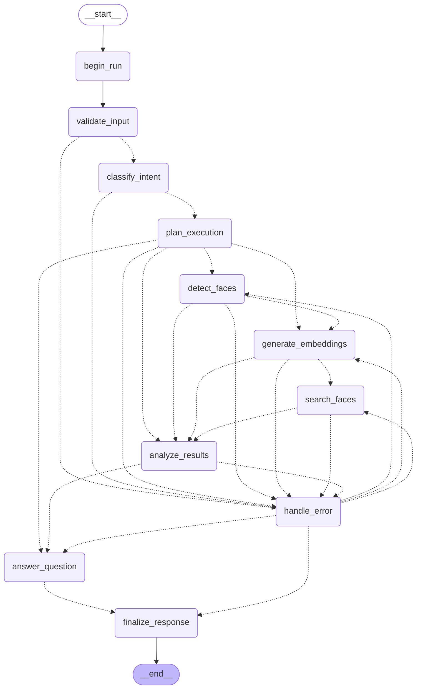

# Face AI Agent

Hệ thống phát hiện khuôn mặt, tìm kiếm khuôn mặt 1:N và trả lời câu hỏi về kết quả, điều phối bằng **LangGraph**, phục vụ qua **FastAPI**, tìm kiếm bằng **FAISS**.

Detection và embedding **không** chạy trong service này — chúng do backend `imintv3` đảm nhiệm qua HTTP (`POST /imintv3/extract_feature/`). Service này là tầng điều phối, so khớp, phân quyền và trả lời.

---

## 1. Đọc phần này trước

Bốn điều dễ hiểu sai nhất, và tất cả đều đã được kiểm chứng bằng cách gọi trực tiếp backend thật:

| Điều | Thực tế |
|---|---|
| **Detector không trả confidence** | `boxes` chỉ có 4 số `[x1,y1,x2,y2]`. Field `confidence` trong response **luôn là `null`**. Kích thước bounding box *không* phải confidence và không được dùng thay. |
| **`similarity_score` không phải xác suất** | Nó là **cosine similarity** trong `[-1, 1]`. Không chuyển thành phần trăm. Muốn có xác suất thì phải hiệu chuẩn riêng (Platt/isotonic) và vẫn phụ thuộc tỷ lệ tiên nghiệm. |
| **Ngưỡng mặc định chưa hiệu chuẩn** | `matching.match_threshold = 0.55` là **placeholder**. Xem `/api/v1/health` → `matching_threshold_calibrated`. Chạy `scripts/calibrate_threshold.py` trước khi dùng cho bất kỳ quyết định nào. |
| **`match_status` có 5 giá trị, không phải 2** | `match`, `ambiguous`, `needs_review`, `no_match`, `no_candidates`. Hai giá trị giữa nghĩa là **không kết luận được** — phải để người xem lại. |

Hệ thống **không** làm, và sẽ từ chối: suy đoán tuổi, giới tính, cảm xúc, chủng tộc; phục vụ việc theo dõi/giám sát người. Những yêu cầu này bị chặn ở `classify_intent` và **không tốn một lời gọi model nào**.

---

## 2. Hợp đồng thật của backend (đã đo, không suy đoán)

Chạy `python scripts/probe_backend.py --image <ảnh có mặt>` để kiểm chứng lại bất cứ lúc nào. Kết quả đo được trên backend hiện tại:

```
POST http://10.9.3.239:3124/imintv3/extract_feature/
{"base64_image": "<base64>", "detect_face": 1, "is_checkresize": true}

200 OK
{
  "message": "success",          <-- discriminator thành/bại
  "trace_message": "",
  "status_respond": 0,
  "result": {
    "features":         [[512 float]],   // ĐÃ L2-normalize, ||v|| = 1.0
    "features_unalign": [[512 float]],   // không gian KHÁC, không trộn được
    "boxes":            [[x1,y1,x2,y2]], // 4 số, KHÔNG có confidence
    "landmarks":        [[10 float]],    // 5 điểm: 2 mắt, mũi, 2 góc miệng
    "request":          { ...echo lại cả base64 ảnh... }
  }
}
```

Những hành vi đã đo và ảnh hưởng trực tiếp tới code:

| Quan sát | Hệ quả thiết kế |
|---|---|
| `\|\|features[i]\|\| == 1.0` | FAISS `IndexFlatIP` cho đúng cosine, không cần normalize thêm |
| `cos(features, features_unalign) ≈ 0.038` trên **cùng** một mặt | Hai không gian khác nhau. Trộn chúng = bug im lặng. `vision.embedding_space` chốt một không gian; index từ chối nạp nếu lệch |
| Ảnh không mặt / mặt 16px → **HTTP 200** nhưng `message="Error"`, list rỗng, `status_respond` vẫn `0` | Discriminator là `message`, **không** phải `status_respond`. "Không có mặt" là kết quả hợp lệ, không phải lỗi |
| base64 rác → **HTTP 500**, body **text thuần** | Không `.json()` mù quáng. Nhưng ảnh được validate phía ta *trước khi* gửi, nên trường hợp này không tới được backend |
| `result.request` echo lại **toàn bộ base64 ảnh** | Bị loại bỏ ngay khi parse: không vào log, không vào state, không vào response |
| Ảnh 3 mặt: boxes **không** theo thứ tự vị trí | Sắp lại theo diện tích giảm dần, tie-break theo toạ độ → `face_index` ổn định giữa các lượt hội thoại |
| Cùng mặt ở 2 tỷ lệ: `cos ≈ 0.995` | Sanity check pipeline |
| Latency một lời gọi: ~0.5–4.5s | Graph được thiết kế để **một ảnh = đúng một lời gọi backend** |

---

## 3. Kiến trúc

```
HTTP (FastAPI)
  ├── /faces/{detect,search,register,delete}  → app/tools/*      (đường trực tiếp, không LLM)
  ├── /agent/chat                             → app/agent/*      (LangGraph)
  └── /tasks, /results, /threads, /health

app/agent/      điều phối: state, graph, node, routing, runner
app/tools/      use-case layer cho đường KHÔNG qua agent (REST + CLI dùng chung)
app/services/   domain: detection, embedding, search (quyết định match_status)
app/vision/     client backend face + validate ảnh    (không biết LangGraph/FastAPI)
app/repositories/  FAISS + result store (SQLite)
app/storage/    kho ảnh tạm (mặc định KHÔNG lưu ảnh truy vấn)
app/security.py Principal, ACL, rate limit
```

Phụ thuộc chỉ đi **một chiều**: `api → tools/agent → services → vision/repositories`. `app/agent` và `app/services` không import FastAPI; `app/vision` và `app/repositories` không import LangGraph. Nhờ vậy mọi tầng test được độc lập, và graph chạy được trong script CLI hay worker queue mà không cần HTTP server.

### Graph

Sơ đồ dưới đây được sinh từ chính object đã compile (`python scripts/draw_graph.py`), nên nó không thể lệch với code. Bản đầy đủ: [`docs/graph.mmd`](docs/graph.mmd).



**Kế hoạch điều khiển luồng.** `plan_execution` tính ra danh sách bước từ intent; mỗi router chỉ trả lời một câu hẹp: "node vừa chạy có lỗi không, và bước kế tiếp trong kế hoạch là gì". Thêm một intent mới = thêm một kế hoạch, không phải sửa năm hàm router.

| Intent | Các bước chạy | Có gọi model? |
|---|---|---|
| `face_detection` (có ảnh) | detect → analyze → answer | có, 1 lần |
| `face_detection` (không ảnh, có kết quả cũ) | analyze → answer | không |
| `face_search` / `face_detection_and_search` (có ảnh) | detect → embed → search → analyze → answer | có, 1 lần |
| `face_search` (không ảnh, có detection cũ) | embed → search → analyze → answer | **không** — dùng embedding đã lưu |
| `result_question` | analyze → answer | không |
| `general_face_question` | answer | không |
| `unsupported_request` | — (bị chặn ở plan) | không |

---

## 4. Thiết kế state

### Ba lớp dữ liệu, ba chỗ khác nhau

| Loại | Ở đâu | Được checkpoint? | Ví dụ |
|---|---|---|---|
| Thay đổi khi chạy | `FaceAgentState` | có | `intent`, `detection_summary`, `errors` |
| Chỉ đọc, 1 lần chạy | `FaceAgentContext` (`context_schema`) | **không** | `principal`, `collection`, `ImageBuffer` |
| Dependency | `FaceAgentContext.deps` | **không** | service, repository, LLM client |

**Bytes ảnh và embedding không nằm trong state.** Ba lý do: checkpointer serialize state sau *mỗi* super-step (một ảnh 5 MB sẽ được ghi lại nhiều lần trong một lần chạy); `bytes`/`np.ndarray` không phải JSON; và ảnh mặt người là dữ liệu sinh trắc học — thứ nằm trong checkpoint là thứ tồn tại lâu dài trên đĩa.

Thay vào đó: ảnh sống trong `ImageBuffer` thuộc context (chỉ trong RAM, chỉ trong một lần chạy), state mang `image_refs`. Embedding sống trong result store có TTL + ACL, state mang `embedding_source_result_id` + `query_face_indices`. Có một test khoá lại bất biến này (`test_agent_state_has_no_binary_or_vector_fields`).

### Node nào ghi/đọc field nào

| Field | Reducer | Ghi bởi | Đọc bởi |
|---|---|---|---|
| `messages` | `add_messages` | runner (Human), answer (AI) | — (ngữ cảnh hội thoại) |
| `capabilities` | ghi đè | validate, intent, plan, embed | intent, plan, analyze |
| `intent`, `intent_source` | ghi đè | classify_intent | plan, analyze, answer |
| `execution_plan` | ghi đè | plan_execution | mọi router |
| `image_refs` | ghi đè | runner (input) | validate, detect |
| `detection_result_id`, `detection_summary` | ghi đè | detect_faces, analyze | embed, analyze, answer |
| `embedding_source_result_id`, `query_face_indices` | ghi đè | generate_embeddings | search_faces |
| `search_result_id`, `search_summary` | ghi đè | search_faces, analyze | analyze, answer |
| `grounding` | ghi đè | analyze, answer | answer (**chỉ** field này vào prompt) |
| `answer`, `answer_source` | ghi đè | answer_question, finalize | finalize |
| `status`, `retry_count`, `retry_target` | ghi đè | begin, handle_error, finalize | router |
| `failed_node` | ghi đè | decorator `graph_node` | mọi router |
| `errors`, `trace`, `executed_steps` | `append_run_scoped` | decorator `graph_node` | handle_error, answer, finalize |
| `warnings` | `dedup_append` | gần như mọi node | answer, finalize |

### Hai cái bẫy đã gặp thật (và test khoá lại)

**1. Field tích lũy sống qua nhiều lượt.** Checkpoint nạp lại state theo `thread_id`, nên một channel `operator.add` thuần sẽ mang theo dữ liệu của **mọi lượt trước**: lượt 2 báo là nó đã chạy `detect_faces` (thật ra lượt 1 chạy), lỗi của lượt 1 vẫn nằm trong response lượt 3. Và không thể reset bằng cách gửi `[]` — với phép nối thì `[]` không xoá gì.

Giải pháp: reducer coi `update is None` là "lượt mới, xoá sạch", và node `begin_run` gửi tín hiệu đó. Reset **không** gửi được từ input: với `input_schema` hẹp, LangGraph lọc bỏ **im lặng** mọi key ngoài schema — đúng loại bug chỉ lộ ra ở lượt thứ hai. Nó cũng không nằm trong `validate_input` được, vì node đó có thể lỗi và nhánh lỗi chỉ trả về `errors`.

**2. Router không được suy "ai vừa lỗi" từ `errors[-1]`.** Sau một lần retry **thành công**, lỗi cũ vẫn nằm trong `errors` (đó là lịch sử, người gọi cần thấy), nên `errors[-1].node` vẫn trỏ vào node vừa chạy *thành công* — router lại đẩy nó về `handle_error`, và một lần retry thành ba lần. Giải pháp: channel `failed_node` riêng, do decorator đặt khi lỗi và **xoá** khi thành công.

### Reducer

- `operator.add` không dùng cho field nào ở đây — mọi field tích lũy cần ngữ nghĩa reset theo lượt.
- `dedup_append` (tự viết) cho `warnings`: nhiều node cùng báo "ngưỡng chưa hiệu chuẩn" là chuyện bình thường; dedup thuộc về *cách gộp của channel*, không phải việc của từng node — nếu để node tự kiểm tra trùng thì mỗi node phải đọc giá trị cũ, đúng thứ mà partial update sinh ra để tránh.
- Hai node song song cùng ghi field **không có reducer** → `InvalidUpdateError`. Graph này tuần tự nên không gặp, nhưng cách chia field giữ cho nó vẫn đúng nếu về sau có fan-out. Có test đối chứng: cùng field, cùng hai node, **tuần tự** thì hợp lệ — `InvalidUpdateError` là lỗi về *đồng thời*, không phải về "hai node cùng ghi một field".

---

## 5. Những quyết định cần giải thích

**Không dùng LLM tool-calling.** Mọi thao tác ở đây đều xác định rõ: validate ảnh, gọi detector, truy vấn vector. Để LLM quyết định "có nên gọi detector không" là đổi một nhánh `if` tất định thành một lời gọi mạng có thể lỗi và có thể chọn sai. Việc chọn bước nào chạy thuộc về `plan_execution`, tính bằng code từ intent. `app/tools/*` là use-case layer cho đường REST/CLI; chúng đã có schema và đã kiểm quyền, nên nếu sau này cần một agent kiểu ReAct thì chúng là thứ đem bọc `@tool`.

**LLM là tuỳ chọn, và mọi con số không đi qua nó.** `llm.enabled=false` → intent do rule quyết định, câu trả lời do template sinh ra từ cùng một `grounding`. **Con số trong hai chế độ là như nhau** vì cả hai đọc chung một nguồn. LLM lỗi → node answer rơi về template, request không bao giờ sập vì LLM. `answer_source` trong response nói rõ phần văn bản do template hay do model sinh.

**Intent: rule trước, LLM chỉ khi rule tự nhận là không chắc.** `classify_by_rules` là hàm thuần, test được đến từng nhánh, chạy trong micro-giây. Nó trả về `confident=False` khi câu mơ hồ; chỉ lúc đó mới gọi LLM (nếu được bật). LLM lỗi → giữ kết quả rule + một warning.

**Không fan-out theo từng khuôn mặt.** Một ảnh nhiều mặt nghe như map-reduce, nhưng FAISS tìm theo batch trong một lời gọi (`BaseFaceSearchRepository.search` nhận **ma trận** `(n, dim)`). Fan-out n nhánh để mỗi nhánh làm một phần của việc vốn đã là một lời gọi thì chỉ thêm n super-step và thêm nhu cầu reducer, mà không nhanh hơn. Khi nào `Send` mới đúng chỗ: nhiều **ảnh** *và* backend chịu được request song song.

**Không dùng `retry_policy` của LangGraph.** `RetryPolicy` chỉ kích hoạt khi exception *thoát ra khỏi* node, nhưng decorator `graph_node` cố tình bắt mọi exception và biến thành `ErrorEntry` trong state — vì người gọi API cần một response đúng schema kèm `request_id`, không phải một stack trace. Hai cơ chế loại trừ nhau; khai báo cả hai để lại một cơ chế chết. Retry nằm ở đúng hai tầng, cả hai đều thật: **transport** (`ImintV3FaceEngine._post_with_retry`, backoff luỹ thừa, retry timeout/5xx, không retry 4xx) và **luồng** (`handle_error` → cạnh quay lại node đã lỗi, chặn bởi `graph.max_node_retries`).

**Retry dựa trên `retryable` của chính exception, không suy từ HTTP status.** Backend trả 500 vì ảnh không giải mã được là lỗi 5xx nhưng **không** retry được; timeout thì retry được. Suy từ status code thì cả hai thành "5xx, thử lại đi" và ta gửi lại cùng một ảnh lỗi ba lần.

**Một ảnh = một lời gọi backend.** `imintv3` trả box + landmark + embedding trong *một* lời gọi, nên `detect_faces` lưu luôn embedding vào result store; `generate_embeddings` đọc lại từ đó thay vì gọi backend lần hai. Điều này cũng làm luồng hỏi tiếp ("tìm khuôn mặt thứ hai") chạy được mà không cần gửi lại ảnh — và khiến đường đi của lượt đầu và lượt sau **dùng chung một code path**, nên không thể lệch logic. Có test khoá lại: `test_single_backend_call_per_image_in_search_flow`.

**Kết quả máy học không đọc từ lịch sử hội thoại.** Khi người dùng hỏi "kết quả thứ hai có similarity bao nhiêu?", câu trả lời lấy từ **result store có cấu trúc + phân quyền**, không lấy từ text mà LLM đã viết ở lượt trước. Đọc lại văn bản của chính mình là nhân bản sai số của chính mình. `thread_id` kéo theo hai thứ khác nhau: lịch sử hội thoại (trong checkpoint) và kết quả máy học (trong result store, có owner + TTL).

**Ba loại ID, đừng lẫn:**
- `thread_id` — một cuộc hội thoại. Khoá checkpoint của LangGraph.
- `request_id` — một lần gọi API. Dùng để trace/log; mỗi lượt chat một `request_id`.
- `result_id` — một kết quả detection/search cụ thể. Đây là thứ được tham chiếu khi hỏi tiếp, và là thứ có ACL + TTL.

---

## 6. Cài đặt và chạy

### Yêu cầu
Python 3.11+ (đã test trên 3.12), truy cập mạng tới backend `imintv3`. **Không cần GPU** — service không chạy model.

### Chạy trực tiếp

```bash
cd Face_AI_Agent
python -m venv .venv && source .venv/bin/activate   # Windows: .venv\Scripts\activate
pip install -r requirements.txt

cp .env.example .env          # sửa FACE_AI_VISION_BASE_URL nếu cần

# 1. Kiểm chứng backend đúng những giả định của hệ thống
python scripts/probe_backend.py --image /path/to/face.jpg

# 2. Nạp một index thử nghiệm (dữ liệu tổng hợp, không dùng ảnh người thật)
python scripts/make_synthetic_index.py --subjects 20 --images-per-subject 2

# 3. Chạy API
uvicorn app.main:app --reload --port 8000
```

Swagger UI: <http://localhost:8000/docs> · OpenAPI: `/openapi.json`

### Docker (CPU — mặc định)

```bash
docker compose up --build
docker compose exec api python scripts/make_synthetic_index.py --subjects 20
curl http://localhost:8000/api/v1/health
```

`docker-compose.yml` mount volume `face-ai-data` cho `/app/data` — index FAISS, result store và checkpoint. **Không mount thì mất hết mỗi lần restart.** Volume này chứa embedding, tức dữ liệu sinh trắc học: áp dụng cùng chính sách bảo vệ/sao lưu/xoá như với cơ sở dữ liệu nhân sự.

### Docker GPU

Chỉ cần khi bạn đưa model vào chạy *trong* service này. Mặc định thì không: GPU nằm ở phía backend `imintv3`. Xem `docker-compose.gpu.yml` và phần cuối `Dockerfile`.

```bash
docker run --rm --gpus all nvidia/cuda:12.4.1-base-ubuntu22.04 nvidia-smi   # kiểm tra host
docker compose -f docker-compose.yml -f docker-compose.gpu.yml up --build
```

### Nạp dữ liệu thật

```bash
# Một khuôn mặt
python scripts/register_face.py --image alice.jpg --subject-id alice \
    --consent-ref "consent://hr/2026-01-15/alice" --metadata dept=eng

# Cả thư mục: dataset/<subject_id>/*.jpg
python scripts/build_index.py --dataset ./dataset --consent-ref "consent://hr/2026-01" --dry-run
python scripts/build_index.py --dataset ./dataset --consent-ref "consent://hr/2026-01"
```

Ảnh có nhiều khuôn mặt **phải** chỉ rõ `--face-index`: hệ thống không tự chọn, vì đăng ký sai người làm bẩn index và rất khó phát hiện về sau.

---

## 7. API

### `POST /api/v1/faces/detect`

```bash
curl -X POST http://localhost:8000/api/v1/faces/detect \
  -H 'Content-Type: application/json' \
  -H 'Authorization: Bearer dev-token' \
  -d "{\"images_base64\": [\"$(base64 -w0 face.jpg)\"]}"
```

```json
{
  "request_id": "req_...", "result_id": "det_...",
  "image_count": 1, "total_face_count": 2, "usable_face_count": 1,
  "detector_confidence_available": false,
  "confidence_note": "backend không trả confidence của detector; chỉ có kích thước bounding box, và kích thước KHÔNG phải confidence",
  "embedding_space": "aligned", "embedding_dim": 512,
  "faces": [
    {"face_index": 0, "global_face_index": 0, "box": [37.38, 18.99, 97.41, 94.81],
     "landmarks": [{"name": "left_eye", "x": 52.03, "y": 52.64}, "..."],
     "confidence": null, "confidence_source": "unavailable_from_backend",
     "size": {"width_px": 60.0, "height_px": 75.8, "area_px": 4552.3, "relative_area": 0.20786},
     "has_embedding": true, "usable_for_search": true, "rejected_reason": null},
    {"face_index": 1, "global_face_index": 1, "confidence": null,
     "usable_for_search": false, "rejected_reason": "face_too_small: cạnh nhỏ nhất 15px < 32px", "...": "..."}
  ],
  "warnings": ["ảnh #0: face #1 bị loại khỏi search: quá nhỏ (15x15px)"]
}
```

### `POST /api/v1/faces/search`

```bash
curl -X POST http://localhost:8000/api/v1/faces/search \
  -H 'Content-Type: application/json' -H 'Authorization: Bearer dev-token' \
  -d "{\"image_base64\": \"$(base64 -w0 query.jpg)\", \"top_k\": 5}"
```

```json
{
  "request_id": "req_...", "result_id": "sea_...", "status": "ok",
  "query_face_count": 1, "collection": "default",
  "threshold": {"metric": "cosine", "match_threshold": 0.55, "review_band": 0.05,
                "ambiguous_margin": 0.03, "calibrated": false},
  "top_k": 5, "index": {"total_faces": 40, "total_subjects": 20},
  "results": [{
    "face_index": 0, "match_status": "ambiguous",
    "best_score": 0.812, "runner_up_score": 0.798, "margin": 0.014, "threshold": 0.55,
    "reason": "top1 (0.8120) vượt ngưỡng 0.5500 nhưng chỉ hơn top2 (0.7980) 0.0140 < margin 0.0300: hai ứng viên gần như không phân biệt được, cần người xem lại",
    "candidates": [
      {"rank": 1, "face_id": "face_...", "subject_id": "subject-twin-A", "similarity_score": 0.812,
       "collection": "default", "metadata": {"dept": "eng"}, "metadata_visible": true},
      {"rank": 2, "subject_id": "subject-twin-B", "similarity_score": 0.798, "...": "..."}
    ]
  }],
  "skipped_faces": [], "warnings": ["match_threshold CHƯA được hiệu chuẩn cho model này..."],
  "score_semantics": "similarity_score là cosine similarity trong [-1, 1] giữa hai embedding, KHÔNG phải xác suất cùng danh tính."
}
```

Response **không bao giờ** chứa embedding hay ảnh gốc. `metadata_visible: false` nghĩa là principal không có quyền `face:read_metadata` — vẫn thấy `subject_id` và điểm, chỉ metadata bị ẩn.

### `POST /api/v1/agent/chat`

Kịch bản hỏi tiếp đúng như trong yêu cầu — ba lượt, hai lượt sau **không gửi lại ảnh**:

```bash
# Lượt 1
curl -X POST localhost:8000/api/v1/agent/chat -H 'Content-Type: application/json' \
  -H 'Authorization: Bearer dev-token' \
  -d "{\"message\": \"Có bao nhiêu khuôn mặt?\", \"images_base64\": [\"$(base64 -w0 group.jpg)\"]}"
# -> {"thread_id": "thr_abc", "answer": "Phát hiện 3 khuôn mặt trong 1 ảnh...", ...}

# Lượt 2 - dùng embedding đã lưu của lượt 1
curl -X POST localhost:8000/api/v1/agent/chat -H 'Content-Type: application/json' \
  -H 'Authorization: Bearer dev-token' \
  -d '{"message": "Tìm kiếm khuôn mặt thứ hai", "thread_id": "thr_abc"}'
# -> executed_steps KHÔNG có detect_faces; search trên face_index 1

# Lượt 3 - không chạy model nào
curl -X POST localhost:8000/api/v1/agent/chat -H 'Content-Type: application/json' \
  -H 'Authorization: Bearer dev-token' \
  -d '{"message": "Kết quả thứ nhất có similarity bao nhiêu?", "thread_id": "thr_abc"}'
# -> intent=result_question; con số trùng khớp tuyệt đối với lượt 2
```

Những câu hỏi khác mà agent xử lý được: *"Khuôn mặt nào có confidence cao nhất?"* (→ nói rõ **không có** confidence, và chỉ so sánh được theo kích thước, kèm cảnh báo kích thước không phải confidence), *"Tại sao hệ thống không tìm thấy kết quả phù hợp?"*, *"So sánh similarity của các kết quả"*, *"Giải thích sự khác biệt giữa confidence của detector và similarity score"*.

### Các endpoint còn lại

| Endpoint | Việc |
|---|---|
| `POST /api/v1/faces/register` | đăng ký khuôn mặt (201) |
| `POST /api/v1/faces/delete` | xoá/thu hồi theo `face_id` |
| `GET /api/v1/tasks/{request_id}` | tra lại kết quả theo `request_id` (hệ thống xử lý **đồng bộ**; endpoint này để tra lại khi client mất response, và là chỗ sẵn sàng cho chế độ async) |
| `GET /api/v1/results/{result_id}` | đọc một kết quả đã lưu |
| `GET /api/v1/results/{result_id}/explain` | vì sao ra trạng thái đó, kèm `what_would_change_it` |
| `GET /api/v1/threads/{thread_id}/results` | kết quả còn hiệu lực của một thread |
| `GET /api/v1/health` | trạng thái + cảnh báo vận hành |

### Hình dạng lỗi

Mọi lỗi (kể cả lỗi schema của FastAPI) đều có một hình dạng:

```json
{"request_id": "req_...",
 "error": {"code": "image_too_large", "message": "...", "retryable": false,
           "details": {"size_bytes": 12582912, "max_bytes": 8388608}}}
```

`retryable` là thuộc tính của **lớp lỗi**, không suy từ status code. `details` của lỗi schema cố tình **bỏ** field `input` của pydantic: với endpoint nhận base64, `input` sẽ là cả tấm ảnh nằm trong response lỗi và trong log.

| code | HTTP | retry? |
|---|---|---|
| `unauthenticated` / `access_denied` | 401 / 403 | không |
| `invalid_input` / `image_decode_failed` / `unsupported_image_type` | 422 | không |
| `image_too_large` | 413 | không |
| `rate_limited` | 429 | **có** (xem `details.retry_after_seconds`) |
| `vision_backend_rejected_image` | 422 | không (dù backend trả 5xx) |
| `vision_backend_error` / `vision_backend_timeout` | 502 / 504 | **có** |
| `vector_store_error` | 503 | **có** |
| `unsupported_request` | 400 | không |

---

## 8. Ngưỡng và hiệu chuẩn

### Năm trạng thái

```
                        top1 >= threshold ?
                       /                   \
                     có                    không
                    /                        \
     margin >= ambiguous_margin ?      top1 >= threshold - review_band ?
        /              \                   /                  \
      có              không              có                  không
       |                |                 |                     |
    match          ambiguous         needs_review            no_match

          Không có ứng viên nào  ->  no_candidates
```

`no_candidates` **khác** `no_match`: index rỗng hoặc filter loại hết nghĩa là ta không so sánh với gì cả, nên không kết luận được gì. `ambiguous` và `needs_review` nghĩa là **không được tự chọn** — phải để người xem lại.

### Hiệu chuẩn

```bash
# Tập validation: validation_set/<subject_id>/*.jpg (mỗi người >= 2 ảnh)
python scripts/calibrate_threshold.py --dataset ./validation_set

# Hoặc từ file cặp có nhãn: path_a,path_b,same|diff
python scripts/calibrate_threshold.py --pairs pairs.csv

# Thử script trên dữ liệu tổng hợp (KHÔNG dùng số kết quả cho hệ thống thật)
python scripts/calibrate_threshold.py --synthetic 40
```

Script in ra phân bố similarity của cặp genuine/impostor, ngưỡng tại các mức **FMR** mục tiêu (1e-1 … 1e-4), **FNMR** tương ứng, EER, và đoạn YAML để dán vào config.

Hai loại sai đánh đổi với nhau: **FMR** (hai người khác nhau bị coi là khớp — loại sai gây hậu quả cho người bị nhận dạng nhầm) và **FNMR** (hai ảnh cùng người bị coi là không khớp — gây bất tiện). Chọn ngưỡng = chọn điểm làm việc theo *hậu quả* của từng loại sai trong hệ thống của bạn. **EER chỉ để so sánh model, không dùng làm ngưỡng vận hành**: nó coi hai loại sai có hậu quả như nhau, điều gần như không bao giờ đúng.

Giới hạn thống kê: muốn đo FMR ở mức 1e-4 có ý nghĩa thì cần cỡ 10⁴–10⁵ cặp impostor. Script in ra mức FMR thấp nhất còn *đo được* với tập của bạn và nói rõ mức nào chỉ là nội suy.

Sau khi hiệu chuẩn: cập nhật `matching` trong `configs/config.yaml` và đặt `calibrated: true`. Trước đó, `/health` trả `degraded` và mọi kết quả search kèm cảnh báo.

**Ngưỡng hiệu chuẩn trên dữ liệu tổng hợp không dùng được cho dữ liệu thật** — phân bố similarity của vector ngẫu nhiên khác hoàn toàn phân bố của khuôn mặt thật.

---

## 9. Bảo mật và quyền riêng tư

| Biện pháp | Ở đâu |
|---|---|
| Mọi truy vấn index và mọi lần đọc kết quả đi qua `Principal` **bắt buộc** | `repositories/*`, `services/*` — không thể viết lời gọi bỏ qua phân quyền |
| Lọc owner nằm **trong câu SQL**, không phải kiểm tra sau | `result_store.latest/list_for_*` — thread_id/request_id của người khác không trả ra gì |
| MIME xác định bằng **magic bytes**, không tin header/tên file | `vision/preprocessing.sniff_mime` |
| Chặn decompression bomb: đọc header **trước khi** decode pixel | `validate_image_bytes` |
| Ảnh truy vấn **mặc định không lưu** | `storage.persist_query_images = false` |
| Embedding + kết quả có **TTL**, dọn lúc startup | `storage.result_ttl_seconds`, `purge_expired()` |
| Response **không bao giờ** chứa embedding hay ảnh gốc | có test bất biến |
| Log **không bao giờ** chứa ảnh, embedding, API key | `logging_utils._scrub` — cắt theo tên key *và* theo độ dài chuỗi |
| `result.request` (echo cả ảnh từ backend) bị loại ngay khi parse | `imint_v3._parse` |
| Rate limit theo **principal**, không theo IP | NAT chung không chặn lẫn nhau; đổi IP không thoát |
| Quyền tách riêng: `face:search`, `face:register`, `face:delete`, `face:read_metadata` | `security.py` |
| Thiếu `consent_ref` khi đăng ký → **WARNING** trong log | `search_service.register_faces` |
| Quyền xoá dữ liệu của chủ thể | `result_store.delete_for_owner`, `POST /faces/delete` |
| Không xác thực + môi trường ≠ dev → **401** | `api/deps.py` — không tự mở cửa vì ai đó quên cấu hình |

**Quyết định cần biết:** đọc kết quả của người khác trả **403**, không phải 404. 403 có tiết lộ rằng `result_id` đó tồn tại; đổi lại nó rõ ràng cho việc debug và cho log audit. `result_id` là chuỗi 16 hex ký tự do server sinh, không enumerable. Nếu bối cảnh của bạn cần không tiết lộ sự tồn tại, đổi `require_owner` thành raise `ResultNotFound`.

**Phần cố tình để đơn giản (DEMO), phải thay trước khi lên production:**
- Xác thực bằng bearer token tĩnh từ env (`TokenPrincipalStore`) → thay bằng OIDC/JWT; chỉ cần sửa `resolve_principal`.
- Rate limit in-process → với nhiều replica, hạn mức thực tế là `limit × số_replica`. Dùng Redis.
- SQLite cho result store và checkpoint → PostgreSQL (`PostgresSaver`).
- Kho ảnh trên filesystem → object storage có encryption + lifecycle rule.

**Không dùng face search làm cơ sở duy nhất cho quyết định có hậu quả nghiêm trọng.** Hệ thống trả `ambiguous`/`needs_review` thay vì khẳng định danh tính chính là để chỗ cho người xem lại — đừng bỏ qua chúng.

---

## 10. Test

```bash
pip install -r requirements-dev.txt
pytest                      # 204 test
pytest --cov=app            # kèm coverage
pytest tests/test_graph_flows.py -v   # 10 tình huống trong yêu cầu
```

Không test nào gọi backend thật; `FakeFaceEngine` sinh vector **có cấu trúc** (cùng identity → cos ≈ 0.995, khác identity → cos ≈ 0), nên logic ngưỡng/margin/`match_status` được kiểm trên dữ liệu thật sự có ý nghĩa. Không dùng danh tính người thật: ảnh test là hình khối do PIL vẽ, embedding sinh từ chuỗi identity tổng hợp.

| File | Phủ |
|---|---|
| `test_vision_imint.py` | adapter backend với response **đúng hình dạng thật**, gồm cả `message="Error"`, HTTP 500 text thuần, echo base64, confidence `null`, sai dim, trộn không gian embedding |
| `test_preprocessing.py` | magic bytes, giới hạn kích thước, decompression bomb, base64 nghiêm ngặt, data-URL, thứ tự khuôn mặt ổn định |
| `test_faiss_repository.py` | cosine đúng, upsert, persistence, **từ chối nạp index khác không gian embedding**, ACL, visibility, metadata filter |
| `test_search_service.py` | 5 trạng thái + biên ngưỡng, verification 1:1, "mọi kết luận phải kèm số" |
| `test_state_reducers.py` | reducer tự viết, gộp song song, `InvalidUpdateError` **và đối chứng tuần tự**, state không chứa bytes/ndarray, bất biến của dữ liệu tổng hợp |
| `test_intent_and_routing.py` | rule intent (gồm chuẩn hoá chữ "đ"), phân biệt "khuôn mặt thứ hai" vs "kết quả thứ hai", mọi conditional edge, chống vòng lặp retry |
| `test_graph_flows.py` | **10 tình huống** end-to-end qua graph thật |
| `test_security_and_store.py` | parse token, ACL, rate limit, TTL, redaction trong log |
| `test_api.py` | schema, status code, hình dạng lỗi, xác thực, rate limit 429, OpenAPI |

10 tình huống trong `test_graph_flows.py`: (1) ảnh không có mặt → `succeeded`, 0 mặt, nói cả nguyên nhân thường gặp · (2) một mặt · (3) nhiều mặt, index ổn định · (4) ảnh lỗi → chặn **trước** graph, **không tốn** lời gọi backend nào · (5) index rỗng → `no_candidates` ≠ `no_match` · (6) dưới ngưỡng → `no_match` + `needs_review` ở dải biên · (7) hai ứng viên sát nhau → `ambiguous`, không tự chọn · (8) hỏi tiếp 3 lượt, số liệu **trùng khớp** giữa các lượt · (9) đọc chéo session → chặn ở 3 đường (store, graph, `target_result_id` tường minh) · (10) node lỗi → retry thành công / không retry được vẫn giải thích / retry có chặn / exception lạ không thoát khỏi graph.

Ba bug thật đã bị test phát hiện trong lúc dựng project (và bị khoá lại bằng test hồi quy): chữ "đ" không phân rã được bằng NFD nên mọi từ khoá tiếng Việt có "đ" không bao giờ khớp; field tích lũy sống qua nhiều lượt vì checkpoint; router suy "ai vừa lỗi" từ `errors[-1]` làm một lần retry thành ba lần.

---

## 11. Observability

Log JSON có cấu trúc, field cố định: `request_id`, `thread_id`, `node_name`, `latency_ms`, `status`, `error_code`.

```json
{"ts":"2026-10-28T09:12:33","level":"INFO","logger":"app.agent.nodes","message":"node_ok",
 "node_name":"detect_faces","request_id":"req_...","thread_id":"thr_...","status":"ok","latency_ms":412.5}
```

`_scrub` cắt mọi key nhạy cảm *và* mọi chuỗi dài nghi là payload, nhưng vẫn giữ **hình dạng** để debug được (`<redacted str len=5000>`).

**Langfuse** (tuỳ chọn, `observability.langfuse_enabled`): mỗi lần chạy graph là một trace, **mỗi node là một span mang đúng tên đã đăng ký trong `add_node`**. Đó là lý do tên node trong project này đặt theo hành động và không đổi — đổi tên node là đổi cấu trúc trace và làm vỡ dashboard dựng trên tên span. Handler gắn qua `config["callbacks"]`; LangGraph truyền `config` xuyên qua mọi node và Runnable lồng bên trong, nên chỉ cần gắn một lần ở ngoài. Hệ quả: node nào tự tạo `config` mới thay vì nhận và truyền tiếp sẽ làm **mất** phần trace bên dưới nó. Langfuse không cài hoặc thiếu key → tracing tự tắt, không làm sập gì.

---

## 12. Scale và giới hạn đã biết

| Thành phần | Hiện tại | Khi nào phải đổi | Đổi thành |
|---|---|---|---|
| Vector search | FAISS `IndexFlatIP` in-process, exhaustive (**chính xác tuyệt đối**) | > ~10⁶ vector, cần sharding/replica, cần filter ở tầng engine, nhiều process ghi | Elasticsearch kNN / pgvector / Milvus — hiện thực `BaseFaceSearchRepository`, service và graph không đổi một dòng |
| Checkpoint | `SqliteSaver` | nhiều replica | `PostgresSaver` — chỉ sửa `build_checkpointer` |
| Result store | SQLite + WAL | tải ghi cao, nhiều máy | PostgreSQL — interface không đổi |
| Kho ảnh | filesystem | nhiều máy | S3/GCS/MinIO — interface `save/load/delete/purge_expired` không đổi |
| Rate limit | in-process | nhiều replica (hạn mức thực = `limit × replica`) | Redis |
| Xác thực | bearer token tĩnh | **mọi** triển khai thật | OIDC/JWT |
| Worker | 1 uvicorn worker | — | cần đổi 3 mục trên trước, vì FAISS index và SQLite nằm trong process/trên file cục bộ |
| Over-fetch khi filter | `top_k × 4 + 20` rồi lọc theo ACL/metadata | filter loại phần lớn index → có thể không lấp đủ `top_k` | backend filter được ở tầng engine |

Giới hạn không phải về scale: ngưỡng chưa hiệu chuẩn (phải chạy `calibrate_threshold.py`); backend không trả confidence (không sửa được từ phía này); chế độ xử lý là đồng bộ (`/tasks/{request_id}` đã sẵn chỗ cho async).

---

## 13. Cấu trúc file

```
Face_AI_Agent/
├── app/
│   ├── main.py                  FastAPI app, lifespan, exception handler
│   ├── config.py                YAML + env, thứ tự ưu tiên tường minh
│   ├── dependencies.py          DI: dựng và gắn kết mọi thành phần
│   ├── errors.py                taxonomy lỗi: code + retryable + http_status
│   ├── security.py              Principal, ACL, rate limit
│   ├── logging_utils.py         log JSON + redaction dữ liệu sinh trắc học
│   ├── observability.py         Langfuse (tuỳ chọn), RunnableConfig
│   ├── api/
│   │   ├── deps.py              dependency FastAPI (lớp duy nhất biết HTTP)
│   │   └── v1/                  faces.py · chat.py · results.py · health.py
│   ├── schemas/                 common.py · face.py · agent.py
│   ├── agent/
│   │   ├── state.py             state + context + reducer
│   │   ├── graph.py             dựng & compile graph
│   │   ├── routing.py           conditional edge (hàm thuần)
│   │   ├── runner.py            điểm vào duy nhất cho API và test
│   │   ├── llm.py               bọc LLM (tuỳ chọn)
│   │   ├── prompts.py           prompt + ràng buộc chống bịa số
│   │   └── nodes/               begin · validate · intent · plan · detect · embed
│   │                            search · analyze · answer · error · finalize · common
│   ├── tools/                   detection.py · search.py · results.py
│   ├── services/                detection_service · embedding_service · search_service
│   ├── vision/                  base.py · preprocessing.py · imint_v3.py · fake.py
│   ├── repositories/            base.py · faiss_repository.py · result_store.py
│   └── storage/image_store.py
├── scripts/
│   ├── probe_backend.py         kiểm chứng 8 giả định về backend
│   ├── register_face.py         đăng ký một khuôn mặt
│   ├── build_index.py           nạp cả thư mục
│   ├── make_synthetic_index.py  index thử nghiệm, dữ liệu tổng hợp
│   ├── calibrate_threshold.py   FMR/FNMR/EER + đoạn config đề xuất
│   └── draw_graph.py            Mermaid từ graph thật
├── tests/                       9 file, 204 test
├── configs/config.yaml · .env.example
├── Dockerfile · docker-compose.yml · docker-compose.gpu.yml
└── requirements.txt · requirements-dev.txt · pyproject.toml
```

Về chuyện `app/vision` **không** có thư mục `detectors/` và `embedders/` riêng: backend `imintv3` trả box + landmark + embedding trong **một** lời gọi, nên `analyze()` mới là primitive thật; detect và embed chỉ là hai góc nhìn vào cùng kết quả đó. Hai Protocol `BaseFaceDetector`/`BaseFaceEmbedder` vẫn tồn tại trong `vision/base.py` để tầng service chỉ phụ thuộc đúng phần nó cần, và một adapter hiện thực cả hai. Nếu sau này đổi sang SCRFD + ArcFace chạy local thì tách thành hai adapter riêng, tầng service không phải sửa dòng nào. Tạo thư mục rỗng chỉ để có cấu trúc đẹp thì không.
